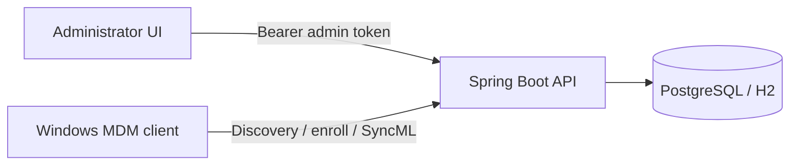

# AppLocker Management Platform

Centralized **Windows AppLocker** policy management for lab and on-premises use. Devices enroll through the native **Windows MDM** client (MS-MDE2) using a **provisioning package (PPKG)** built in **Windows Configuration Designer**. The server issues enrollment tokens and discovery URLs, runs **OMA-DM (SyncML)** management sessions, and delivers **AppLocker StoreApps** Allow/Deny policy through the **AppLocker CSP**.

This repository does **not** build `.ppkg` files. You paste the discovery URL and enrollment secret from this service into WCD.



## Features

| Area | What works today |
|------|------------------|
| Enrollment | On-prem discovery, certificate policy, CSR enrollment, lab CA TLS |
| Tokens | Create, list, revoke enrollment tokens (stored in DB via Flyway) |
| Admin UI | Static dashboard at the public base URL (tokens, devices, AppLocker workspace) |
| Policies | Author Exe/Dll/Msi/Script/Appx rules; **MDM delivery implemented for StoreApps** |
| MDM sync | Two-phase SyncML (diagnostics + AppLocker CSP Replace) |

**Planned** (see [docs/milestones.md](docs/milestones.md)): Redis-backed token TTL, hosted PostgreSQL (Neon), React dashboard, MDM delivery for non-StoreApps collections.

## Requirements

- **JDK 25** (Spring Boot 4.1.x)
- **Windows** test VM or spare PC for enrollment (do not enroll your dev machine)
- **Windows Configuration Designer** to export the PPKG
- Optional: **Docker** for local PostgreSQL (`docker compose up -d`)

## Quick start

### 1. Clone and configure

```powershell
git clone https://github.com/YOUR_USERNAME/Applocker.git
cd Applocker
copy .env.example .env
```

Edit `.env`:

- Set `PUBLIC_BASE_URL` to an address the **test device** can reach (LAN IP, not `localhost`).
- Optionally set `APPLOCKER_ADMIN_TOKEN` to a long random string (recommended for any shared or hosted deploy).
- For PostgreSQL, start `docker compose up -d` and uncomment `DATABASE_*` in `.env` (see [.env.example](.env.example)).

Do **not** commit `.env`. Secrets and lab data stay under `backend/data/` and are listed in [.gitignore](.gitignore).

### 2. Run the backend

Maven is optional; the wrapper in `backend` downloads Maven on first use.

```powershell
cd backend
.\mvnw.cmd verify
.\mvnw.cmd spring-boot:run
```

On first start (local profile):

- Lab CA and server TLS keystore are written under `backend/data/lab-ca/`
- If `APPLOCKER_ADMIN_TOKEN` is unset, an admin token is written to `backend/data/admin-token`

Health check: `GET https://<host>:8443/api/v1/health`

Open the UI at the same base URL. Sign in with the admin token (Bearer value, no `Bearer` prefix in the form).

On macOS or Linux use `./mvnw` instead of `.\mvnw.cmd`.

### 3. Enroll a test device

Follow the step-by-step lab guide:

**[docs/enrollment-lab.md](docs/enrollment-lab.md)**

Summary:

1. Create an enrollment token in the UI or API (`POST /api/v1/enrollment-tokens`).
2. Trust `backend/data/lab-ca/lab-ca.crt` on the **test device only**.
3. In WCD: `AuthPolicy` = `OnPremise`, paste discovery URL and secret.
4. Apply the `.ppkg` on the disposable device.
5. Configure StoreApps deny rules and assign policy so MDM sync can deliver CSP payloads.

## Configuration reference

| Variable | Purpose |
|----------|---------|
| `SPRING_PROFILES_ACTIVE` | `local` (lab TLS, default H2) or `deploy` (PostgreSQL, env secrets) |
| `PUBLIC_BASE_URL` | Must match discovery and TLS host seen by Windows |
| `APPLOCKER_ADMIN_TOKEN` | Protects enrollment-token, policy, and device admin APIs |
| `APPLOCKER_LAB_TLS` | `false` when TLS terminates at a reverse proxy |
| `DATABASE_URL` / `DATABASE_USERNAME` / `DATABASE_PASSWORD` | PostgreSQL; omit for file-backed H2 under `backend/data/` |

Copy from [.env.example](.env.example). Never commit real tokens, keys, `.ppkg`, or CA private material.

## Project layout

```
Applocker/
  backend/           Spring Boot API, static admin UI, Flyway migrations
  docs/              Architecture, security, enrollment lab, milestones
  docker-compose.yml Optional PostgreSQL for local dev
  .env.example       Safe template for environment variables
```

Important backend packages:

- `com.applocker.enrollment` — tokens, MS-MDE2 SOAP, lab CA
- `com.applocker.mdm` — SyncML management and StoreApps delivery
- `com.applocker.policy` — AppLocker XML, workspace, REST APIs
- `com.applocker.security` — Admin bearer token filter

## API overview (admin)

All routes below require `Authorization: Bearer <APPLOCKER_ADMIN_TOKEN>` unless noted.

| Endpoint | Description |
|----------|-------------|
| `GET /api/v1/health` | Public health |
| `POST /api/v1/enrollment-tokens` | Create enrollment token |
| `GET /api/v1/devices` | List enrolled devices |
| `GET/POST /api/v1/applocker/*` | Rules, workspace, StoreApps catalog |
| `/api/v1/mdm/windows/enrollment/*` | **Device-facing** (no admin token) |
| `/api/v1/mdm/windows/management` | **Device-facing** MDM SyncML |

## Tests

```powershell
cd backend
.\mvnw.cmd test
```

## Deploy on Railway

You can host the API, UI, and PostgreSQL on [Railway](https://railway.app). Use **`SPRING_PROFILES_ACTIVE=deploy`**, **`APPLOCKER_LAB_TLS=false`**, a mounted volume at **`/app/data`** for the lab CA, and **`PUBLIC_BASE_URL=https://your-app.up.railway.app`**.

Step-by-step: **[docs/deploy-railway.md](docs/deploy-railway.md)**.

## Documentation

- [Architecture](docs/architecture.md)
- [Security](docs/security.md)
- [Windows provisioning and MDM](docs/windows-management.md)
- [Milestones](docs/milestones.md)
- [Enrollment lab](docs/enrollment-lab.md)
- [Deploy on Railway](docs/deploy-railway.md)

## Security notes

- A `.ppkg` contains the enrollment secret. Anyone with the package can enroll until the token expires, is revoked, or hits its device limit.
- Revoking a token does **not** unenroll devices that already have a client certificate.
- Use HTTPS in production. Set a strong `APPLOCKER_ADMIN_TOKEN` on the host; do not expose admin APIs without authentication on the public internet.
- If you ever shared credentials in chat or logs, rotate your GitHub and admin passwords and issue new tokens.

## License

No license file yet. Treat as private / all rights reserved unless you add a `LICENSE` in the repository.