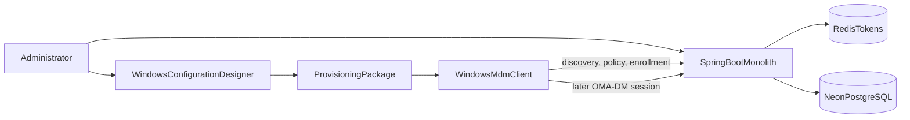
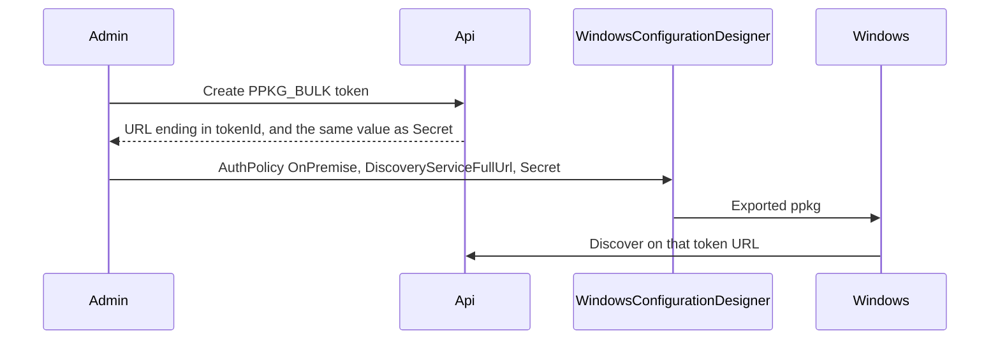
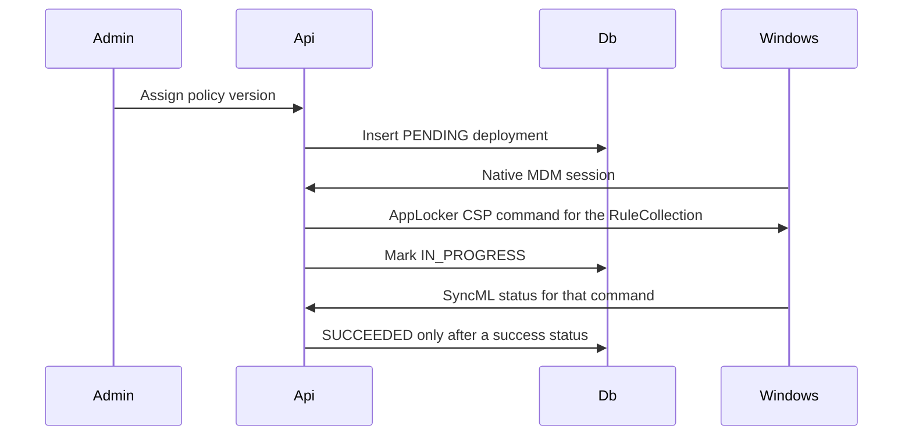

# Architecture

Status: the management path is decided. A lab enrollment service now implements discovery, certificate policy, and enrollment from Microsoft's on-premises example. Token and device state is still in memory. Redis, Neon, and AppLocker delivery are not connected.

## Decision

Windows enrolls and stays managed through its built-in MDM client. A `.ppkg` starts that enrollment. It is not an application installer, and this backend does not generate the package.

The backend issues a reusable `PPKG_BULK` token and forms the discovery URL by appending the token id:

`https://{public-host}/api/v1/mdm/windows/enrollment/discovery/{tokenId}`

`{public-host}` comes from environment configuration. The administrator copies that URL into `DiscoveryServiceFullUrl` and copies the same token into `Secret`, with `AuthPolicy` set to `OnPremise`.

A custom Windows service that polls this backend or applies AppLocker policy locally is out of scope. An agent can be reconsidered only when a requirement cannot be met through native MDM. AppLocker event-log upload is one unresolved gap: delivering policy through the AppLocker CSP does not, by itself, collect the AppLocker event logs.

## Components

| Piece | Role |
| --- | --- |
| Windows Configuration Designer | Builds and exports the `.ppkg`. |
| Provisioning package | Carries `AuthPolicy`, `DiscoveryServiceFullUrl`, and `Secret` into the native enrollment client. |
| Spring Boot monolith | Issues tokens, answers discovery, policy, and enrollment, and later serves MDM commands. |
| Redis | Holds expiring token state and the atomic device count. |
| Neon PostgreSQL | Holds durable devices, policies, deployments, and audit records. |

## What each Windows mechanism does

**Provisioning package.** Microsoft documents bulk on-premises enrollment through Workplace settings and the Provisioning CSP. The enrollment entry is a UPN. `AuthPolicy` is `OnPremise` or `Certificate`. For `OnPremise`, `Secret` is the password string. `DiscoveryServiceFullUrl` is the full discovery URL. The enrollment and policy URL fields are optional and stay empty here, because discovery returns those endpoints. Applying the package starts the native enrollment client. A successful install is not proof that a later MDM session reached this server.

**Enrollment token.** `PPKG_BULK` is this application's name for the reusable secret. It is not a Microsoft protocol field. The token is the only enrollment credential this backend checks. MS-MDE2 still sends an on-premises `UsernameToken` with `PasswordText` on `GetPolicies` and `RequestSecurityToken`. The password must match the token selected by the URL. Which username Windows sends is confirmed from a VM trace in Milestone 7.

**Discovery URL.** The package calls the configured full URL. That is different from DNS discovery, where MS-MDE2 fixes the path `/EnrollmentServer/Discovery.svc`. This project uses the token-scoped path above. The device must trust the TLS certificate on `{public-host}`.

**Enrollment.** After discovery, Windows sends `GetPolicies` as profiled by MS-MDE2 from MS-XCEP, then `RequestSecurityToken` as profiled from MS-WSTEP, including a Base64 PKCS#10 request. The response carries a Base64 WAP provisioning document with the client certificate, trust chain, and DM client settings. The exact elements and faults are taken from those specifications during Milestones 5 and 6. They are not copied from the sample passwords in the provisioning example.

**Ongoing MDM.** The provisioning document points the built-in client at the device-management endpoint. Check-ins, command status, and certificate renewal follow MS-MDM and the DMClient CSP. That work is Milestone 8.

**AppLocker, later.** Policy delivery uses `./Vendor/MSFT/AppLocker/ApplicationLaunchRestrictions/{Grouping}/` with a random GUID grouping. The EXE, DLL, MSI, Script, and StoreApps `Policy` nodes carry AppLocker `RuleCollection` XML. `EnforcementMode` is its own node. The XML collection type for packaged apps in Microsoft's examples is `Appx`. The `CodeIntegrity/Policy` node and the ApplicationControl CSP are App Control for Business, not this project's payload. `Set-AppLockerPolicy` is not the delivery mechanism.

## Token and package sequence

Redis stores the token hash, owner, label, optional maximum device count, enrollment count, expiry, and revocation state. PostgreSQL records the administrative action without the secret.

Expiry is the Redis TTL. The device-count increment is atomic. A retry for a device that already enrolled does not take another slot. If certificate issuance fails after a reservation, the count is released. The device-identity field used for that deduplication is taken from the MS-MDE2 request and CSR in Milestone 6.

Revocation blocks future enrollment. It does not unenroll devices that already received a certificate.

## Backend

One modular monolith on Java 25 and Spring Boot 4.1.1. Official requirements checked on 17 October 2026:

- Spring Boot 4.1.1 supports Java 17 through 26, and Maven 3.6.3 or later.
- Spring Boot 3.5.16 also supports Java 25, and its requirements page points to 4.1.1 as the current stable line. Open-source support for 3.5 ended on 30 June 2026.

Packages, when the code exists: `config`, `security`, `auth`, `device`, `enrollment`, `policy`, `assignment`, `deployment`, `audit`, `common`. An `mdm` package is added with the OMA-DM endpoint. There is no `agent` package.

Controllers delegate. Services own transactions. DTOs cross the HTTP boundary. Management APIs live under `/api/v1`. Identifiers are UUID v4. Profiles are `local`, `deploy`, and `test`. After Flyway creates the schema, Hibernate uses `ddl-auto=validate`. Neon uses separate migrator and application roles. The Redis server version is checked against the Spring Data Redis version managed by Boot 4.1.1 before Milestone 3 depends on it.

## Durable data

Flyway owns schema changes. Token secrets and counters stay in Redis. Neon is intended to hold:

- administrators, roles, and role membership
- devices, including enrollment status, certificate thumbprint and validity, and last MDM session time
- device groups and membership
- policies and immutable policy versions, including validated AppLocker XML
- assignments to a device or a group
- deployments with channel `MDM_SYNCML`, status, attempt count, and a safe error description
- administrative audit events, including token creation and revocation without the secret

A direct device assignment wins. Otherwise the highest-priority group assignment wins. The MDM command replaces the AppLocker CSP grouping managed by this server. It does not claim to merge with Group Policy.

Device-reported AppLocker log events do not have a collection mechanism yet.

## Policy delivery states

`PENDING`, `IN_PROGRESS`, `SUCCEEDED`, `FAILED`, and `CANCELLED`.

The poll schedule, SyncML verb, and status values come from MS-MDM and the DMClient CSP in Milestone 8. Success is not inferred from a row being stored.

The first real AppLocker delivery is audit-only, where that mode is supported. Enforce mode and DLL enforcement require an extra confirmation and are tested only on a disposable VM. A deny-all payload is rejected. Windows 10 version 2004 and later with KB5024351, and Windows 11, can enforce AppLocker on all editions. AppLocker is not supported on Server Core. Microsoft classifies it as defense in depth.

## Open until implementation

- Exact `DiscoverResponse`, `GetPolicies`, and `RequestSecurityToken` fields, copied from MS-MDE2, MS-XCEP, and MS-WSTEP.
- The certificate issuer, key usage, subject, and where the CA private key lives. No issuer exists now.
- How the lab VM trusts the TLS certificate for the public host.
- The username Windows places beside the token password.
- OMA-DM session authentication. The sample `APPAUTH` secrets in the MS-MDE2 provisioning example are not the design.
- Whether any documented MDM mechanism can collect AppLocker event logs. Until that is found, event collection is not designed as an agent.

## Sources

- [Spring Boot 4.1.1 system requirements](https://docs.spring.io/spring-boot/system-requirements.html)
- [Spring Boot 3.5.16 system requirements](https://docs.spring.io/spring-boot/3.5/system-requirements.html)
- [Workplace settings](https://learn.microsoft.com/en-us/windows/configuration/wcd/wcd-workplace)
- [Provisioning CSP](https://learn.microsoft.com/en-us/windows/client-management/mdm/provisioning-csp)
- [Bulk enrollment](https://learn.microsoft.com/en-us/windows/client-management/bulk-enrollment-using-windows-provisioning-tool)
- [On-premises authentication device enrollment](https://learn.microsoft.com/en-us/windows/client-management/on-premise-authentication-device-enrollment)
- [MS-MDE2 discovery](https://learn.microsoft.com/en-us/openspecs/windows_protocols/ms-mde2/2681fd76-1997-4557-8963-cf656ab8d887)
- [MS-MDE2 GetPolicies](https://learn.microsoft.com/en-us/openspecs/windows_protocols/ms-mde2/ff0847a2-c85f-41e6-99f4-b29556f37719)
- [MS-MDE2 RequestSecurityToken](https://learn.microsoft.com/en-us/openspecs/windows_protocols/ms-mde2/09c69d4c-5315-4226-be5e-4cea54058317)
- [MS-MDE2 provisioning schema](https://learn.microsoft.com/en-us/openspecs/windows_protocols/ms-mde2/35e1aca6-1b8a-48ba-bbc0-23af5d46907a)
- [AppLocker CSP](https://learn.microsoft.com/en-us/windows/client-management/mdm/applocker-csp)
- [ApplicationControl CSP](https://learn.microsoft.com/en-us/windows/client-management/mdm/applicationcontrol-csp)
- [Neon secure connections](https://neon.com/docs/connect/connect-securely)
